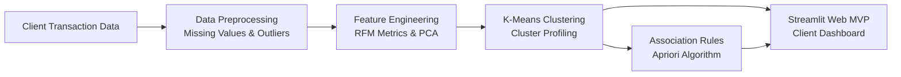

# Customer Segmentation & Behavioral Clustering Pipeline

[](https://www.python.org/)
[](https://streamlit.io/)
[](https://scikit-learn.org/)
[](LICENSE)

An end-to-end customer segmentation and behavioral clustering project designed to group business clients based on their service utilization, transaction frequency, and revenue patterns. The repository includes exploratory data analysis (EDA), data cleaning and feature engineering, unsupervised clustering (K-Means & PCA), Association Rule Mining (Apriori) for product recommendations, and an interactive Streamlit MVP dashboard.

---

## Workflow Overview



### Pipeline Breakdown

1. **Exploratory Data Analysis (`eda/`)**:
   - Monthly transaction volume and revenue distribution analysis.
   - Account receivables and payment behavior analysis.
   - Identification of high-value vs. long-tail client segments.

2. **Data Preprocessing & Transformation (`data-processing/`)**:
   - Treatment of missing values and categorical harmonization.
   - Outlier detection and capping.
   - Aggregation of multi-level product hierarchies and revenue standardization.

3. **Clustering & Modelling (`modelling/`)**:
   - Customer segmentation using **K-Means Clustering** evaluated via Elbow Method and Silhouette Analysis.
   - Dimensionality reduction using **Principal Component Analysis (PCA)** for cluster visualization.
   - Market basket / Association Rule Mining to generate next-best product recommendations per customer cluster.

4. **Interactive Dashboard MVP (`mvp_web/`)**:
   - Streamlit application displaying customer details, assigned cluster profile, and automated personalized service recommendations.
   - Document generation utility for automated proposal drafts.

---

## Project Structure

```
customer-segmentation/
├── eda/
│   ├── eda_pendapatan.ipynb          # Revenue and transaction EDA
│   ├── eda_piutang.ipynb             # Receivables and payment trends
│   └── eda_customer_monthly.ipynb    # Monthly client transaction patterns
├── data-processing/
│   ├── missing_value_treatment.ipynb # Cleaning and imputation
│   ├── outlier_treatment.ipynb       # Outlier handling
│   ├── aggregate_product_type.ipynb  # Hierarchy aggregation
│   └── join_customer_type.ipynb      # Customer attribute enrichment
├── modelling/
│   ├── customer-segmentation-modelling-v1.ipynb # Initial K-Means baseline
│   ├── customer-segmentation-modelling-v2.ipynb # Feature-engineered clustering
│   ├── customer-segmentation-modelling-v3.ipynb # Silhouette optimization & PCA
│   ├── product_recommendation_per_cust_type_time_series.ipynb # Product recommendation
│   └── combined_pipeline.ipynb       # Consolidated pipeline
├── mvp_web/
│   ├── app.py                        # Streamlit web application
│   ├── css/simple_css.py             # Custom UI styling
│   ├── template_dokumen/             # Document templates
│   └── dokumen_generator/            # Proposal generator utility
├── results/
│   └── plot/                         # Cluster profile visualizations
├── requirements.txt                  # Python dependencies
└── README.md
```

---

## Getting Started

### 1. Installation
Clone the repository and install required dependencies:
```bash
git clone https://github.com/StevenSiahaann/customer-segmentation.git
cd customer-segmentation
pip install -r requirements.txt
```

### 2. Run the Streamlit Dashboard
```bash
cd mvp_web
streamlit run app.py
```

---

## Author
**Steven Gianmarg Haposan Siahaan**  
GitHub: [@StevenSiahaann](https://github.com/StevenSiahaann)
